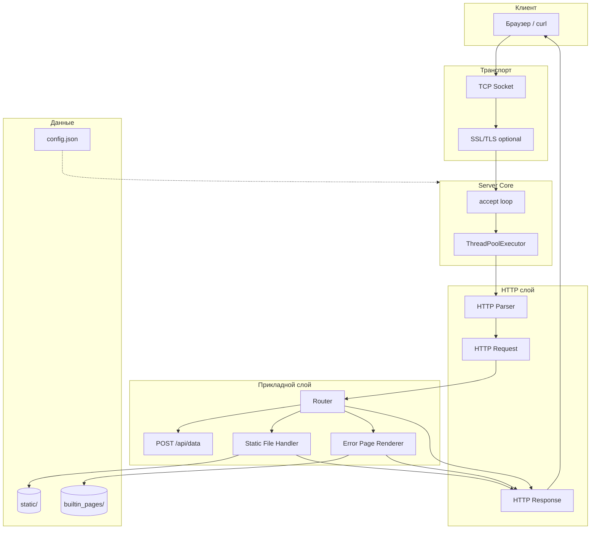
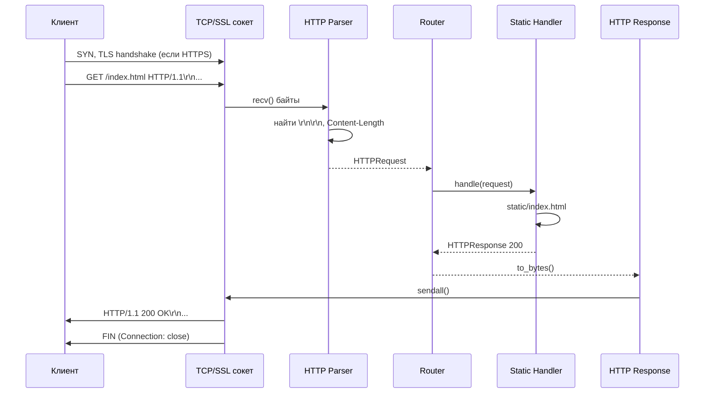
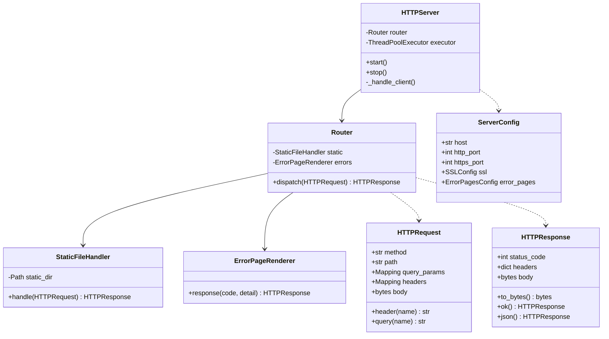
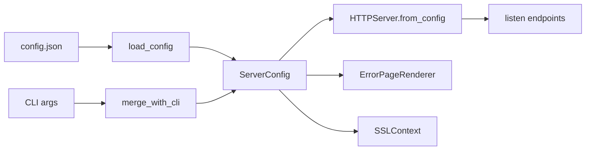
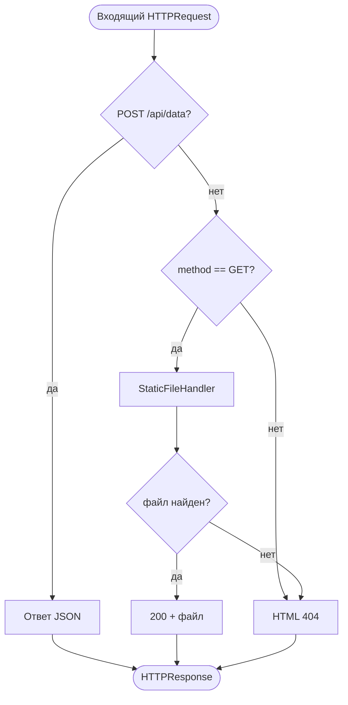
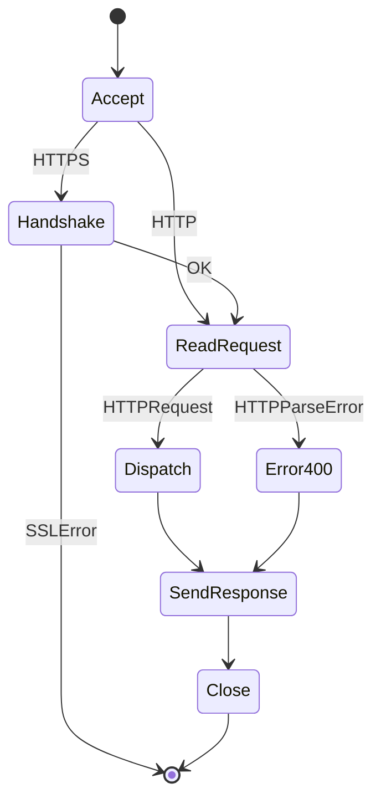
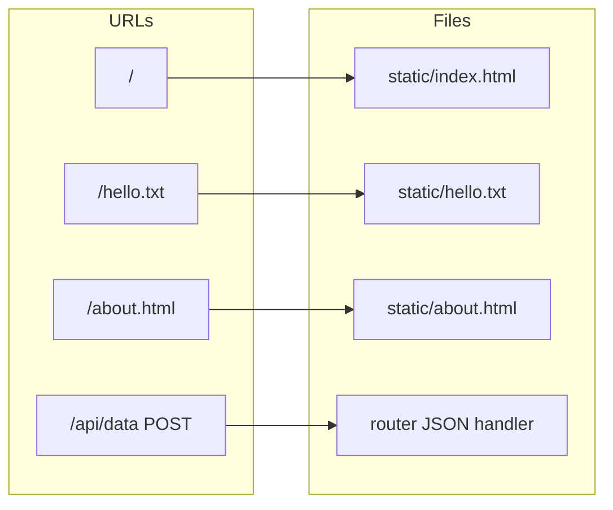
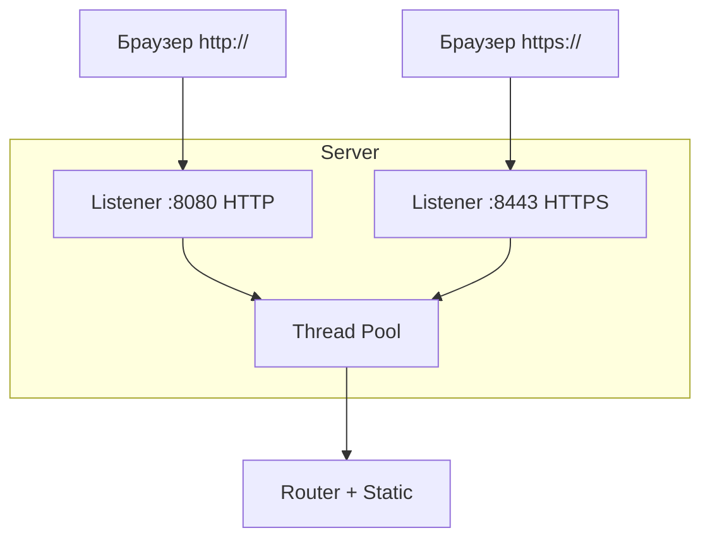
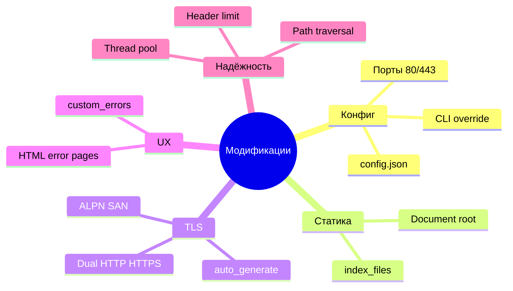

# Техническое руководство: HTTP/1.1 сервер на Python с нуля

Полный туториал по проекту **python-http-server**: создание технологии с нуля, разбор кода, настройка, эксплуатация и описание доработок сверх базовой реализации.

---

## Содержание

1. [Введение](#1-введение)
2. [Архитектура системы](#2-архитектура-системы)
3. [Создание сервера с нуля: пошаговый план](#3-создание-сервера-с-нуля-пошаговый-план)
4. [Разбор модулей с примерами кода](#4-разбор-модулей-с-примерами-кода)
5. [Руководство пользователя](#5-руководство-пользователя)
6. [Настройка config.json](#6-настройка-configjson)
7. [Модификация: доработки сверх базовой реализации](#7-модификация-доработки-сверх-базовой-реализации)
8. [Отладка и типичные проблемы](#8-отладка-и-типичные-проблемы)

---

## 1. Введение

### 1.1. Цель проекта

Реализовать **минимальный, но полноценный HTTP/1.1 веб-сервер** на языке Python:

- только **стандартная библиотека** (без Flask, Django, `requests`, `httpx` и т.п.);
- транспорт — **TCP-сокеты** (`socket`);
- разбор протокола — **вручную**;
- поддержка **GET** и **POST**, заголовков, query-параметров, тела POST;
- ответы **200**, **404**, **500**;
- **роутинг**, **статические файлы**, **многопоточность**, **логирование**.

### 1.2. Требования

| Компонент | Версия |
|-----------|--------|
| Python | 3.10+ (рекомендуется 3.11+) |
| OpenSSL CLI | для автогенерации TLS (опционально) |
| ОС | Linux, macOS, Windows (WSL) |

### 1.3. Структура репозитория

```
python-http-server/
├── main.py                 # Точка входа
├── config.json             # Конфигурация
├── TUTORIAL.md             # Это руководство
├── README.md               # Краткая справка
├── server/                 # Ядро сервера
│   ├── http_parser.py
│   ├── http_request.py
│   ├── http_response.py
│   ├── router.py
│   ├── static_handler.py
│   ├── server_core.py
│   ├── config.py
│   ├── ssl_support.py
│   ├── error_pages.py
│   └── builtin_pages/      # Встроенные HTML ошибок
├── static/                 # Корень сайта (document root)
├── custom_errors/          # Пример своих страниц ошибок
└── certs/.auto-generated/  # Автогенерируемый TLS (в .gitignore)
```

---

## 2. Архитектура системы

### Иллюстрация 1. Общая архитектура (слои)



**Пояснение:** клиент устанавливает TCP (и при необходимости TLS) соединение. Ядро принимает соединение в пуле потоков, парсер строит `HTTPRequest`, роутер выбирает обработчик, `HTTPResponse` сериализуется в байты и уходит обратно в сокет.

---

### Иллюстрация 2. Диаграмма последовательности (один запрос)



---

### Иллюстрация 3. UML-диаграмма классов (упрощённая)



---

### Иллюстрация 4. Поток данных конфигурации



Приоритет: **CLI перекрывает config.json**.

---

### Иллюстрация 5. Решение роутера (блок-схема)



---

## 3. Создание сервера с нуля: пошаговый план

Ниже — логическая последовательность разработки. Каждый шаг — отдельный модуль; в репозитории всё уже реализовано, но порядок повторяет «как бы писали с нуля».

### Шаг 1. TCP-сервер «Hello»

Создайте файл `hello_server.py`:

```python
import socket

HOST = "127.0.0.1"
PORT = 8080

# AF_INET = IPv4, SOCK_STREAM = TCP
server = socket.socket(socket.AF_INET, socket.SOCK_STREAM)
server.setsockopt(socket.SOL_SOCKET, socket.SO_REUSEADDR, 1)  # быстрый перезапуск
server.bind((HOST, PORT))
server.listen(128)

while True:
    client, addr = server.accept()
    print("Подключение:", addr)
    # Отправляем сырой HTTP-ответ вручную
    client.sendall(b"HTTP/1.1 200 OK\r\nContent-Length: 2\r\n\r\nOK")
    client.close()
```

**Проверка:** `curl http://127.0.0.1:8080/` → `OK`.

---

### Шаг 2. Модель HTTP Request

Файл `server/http_request.py` — dataclass с полями запроса:

```python
@dataclass(frozen=True)
class HTTPRequest:
    method: str           # GET, POST
    path: str             # /about без query
    query_params: Mapping[str, list[str]]  # ?a=1&a=2
    headers: Mapping[str, str]  # ключи в lower case
    body: bytes
```

Зачем: парсер не разбрасывает данные по функциям, а возвращает один понятный объект.

---

### Шаг 3. HTTP Parser

Алгоритм (`server/http_parser.py`):

1. Читать из сокета до `\r\n\r\n` (граница заголовков).
2. Первая строка: `METHOD /target HTTP/1.1`.
3. Остальные строки до пустой — заголовки `Name: Value`.
4. Из `target` выделить path и query (`/search?q=hi`).
5. По `Content-Length` дочитать тело.

```python
# Упрощённый фрагмент: стартовая строка
request_line = lines[0]  # "GET /path HTTP/1.1"
method, target, http_version = request_line.split()
method = method.upper()

if method not in {"GET", "POST"}:
    raise HTTPParseError(f"Метод не поддерживается: {method}")
```

---

### Шаг 4. HTTP Response

Файл `server/http_response.py` собирает байты ответа:

```python
# Статусная строка + заголовки + пустая строка + тело
lines = [f"HTTP/1.1 {self.status_code} {phrase}"]
for name, value in headers.items():
    lines.append(f"{name}: {value}")
header_block = "\r\n".join(lines) + "\r\n\r\n"
return header_block.encode("iso-8859-1") + self.body
```

Важно: `Connection: close` — один запрос на соединение (упрощение).

---

### Шаг 5. Router

Таблица `(method, path) → handler`. Базовые маршруты:

| Метод | Путь | Действие |
|-------|------|----------|
| GET | `/` | статика → `index.html` |
| GET | `/about` | `about.html` |
| POST | `/api/data` | JSON echo API |

---

### Шаг 6. Static File Handler

Корень сайта = `static_dir`. URL `/css/app.css` → файл `static/css/app.css`.

Обязательно:

- проверка `..` в пути (path traversal);
- `resolve().relative_to(static_dir)` — файл внутри каталога;
- MIME по расширению (`.html`, `.png`, `.json` …).

---

### Шаг 7. Server Core + пул потоков

```python
from concurrent.futures import ThreadPoolExecutor

self._executor = ThreadPoolExecutor(max_workers=8)

while self._running:
    client_socket, address = self._server_socket.accept()
    # Каждый клиент — отдельный поток
    self._executor.submit(self._handle_client, client_socket, address)
```

В `_handle_client`: parse → dispatch → sendall → shutdown → close.

---

### Шаг 8. Логирование и main.py

```python
logging.basicConfig(
    level=logging.INFO,
    format="%(asctime)s [%(levelname)s] %(name)s: %(message)s",
)
```

`main.py` загружает конфиг и запускает `HTTPServer.from_config(...)`.

---

### Иллюстрация 6. Этапы разработки (график Ганта)

```mermaid
gantt
    title Этапы создания сервера с нуля
    dateFormat X
    axisFormat %s

    section Транспорт
    TCP accept           :a1, 0, 1
    section HTTP
    Request model        :a2, 1, 2
    Parser               :a3, 2, 4
    Response             :a4, 3, 4
    section Логика
    Router               :a5, 4, 5
    Static handler       :a6, 5, 6
    Thread pool          :a7, 6, 7
    section Доработки
    Config JSON          :b1, 7, 8
    TLS SSL              :b2, 8, 9
    Error pages          :b3, 9, 10
```



---

## 4. Разбор модулей с примерами кода

### 4.1. HTTP Parser — чтение заголовков

```python
def _recv_until_headers(connection: socket.socket) -> bytes:
    buffer = bytearray()
    while True:
        chunk = connection.recv(4096)  # порция до 4 КБ
        if not chunk:
            break
        buffer.extend(chunk)
        if len(buffer) > MAX_HEADER_SIZE:  # защита от DoS
            raise HTTPParseError("Заголовки запроса слишком большие")
        if b"\r\n\r\n" in buffer:        # конец заголовков HTTP/1.1
            break
    return bytes(buffer)
```

### 4.2. Query-параметры без HTTP-библиотек

```python
# "name=Алекс&msg=Привет" → {"name": ["Алекс"], "msg": ["Привет"]}
for pair in query.split("&"):
    key, value = pair.split("=", 1) if "=" in pair else (pair, "")
    decoded_key = unquote_plus(key)    # + → пробел, %XX → символ
    params.setdefault(decoded_key, []).append(unquote_plus(value))
```

### 4.3. Static Handler — сопоставление URL

```python
# / → static/index.html
# /about → static/about.html (если нет файла about)
direct = self.static_dir / relative
if direct.is_file():
    return direct
if not Path(relative).suffix:
    html_path = self.static_dir / f"{relative}.html"
    if html_path.is_file():
        return html_path
```

### 4.4. TLS — обёртка после accept

```python
client_socket, address = listener.accept()
if use_tls:
    # TLS на каждое соединение — совместимость с браузерами
    client_socket = self._ssl_context.wrap_socket(
        client_socket,
        server_side=True,
    )
```

### 4.5. Страницы ошибок

```python
# Встроенные шаблоны НЕ в static/
BUILTIN_PAGES_DIR = Path(__file__).parent / "builtin_pages"

def response(self, status_code: int, detail: str | None = None) -> HTTPResponse:
    html = self._render_html(status_code, detail)
    response = HTTPResponse(status_code=status_code)
    response.set_body(html.encode("utf-8"), "text/html; charset=utf-8")
    return response
```

Плейсхолдеры `{code}`, `{title}`, `{message}` подставляются без `.format()`, чтобы не ломать CSS `{ ... }`.

---

### Иллюстрация 7. Конечный автомат обработки соединения



---

## 5. Руководство пользователя

### 5.1. Установка и первый запуск

```bash
cd python-http-server
python3 main.py
```

По умолчанию (из `config.json` при `ssl.enabled: false`):

- **http://127.0.0.1:8080/**

При текущем конфиге с SSL:

- **http://127.0.0.1:8080/**
- **https://127.0.0.1:8443/**

### 5.2. Команды CLI

| Аргумент | Описание |
|----------|----------|
| `--config PATH` | Альтернативный JSON-конфиг |
| `--host IP` | Адрес привязки |
| `--http-port N` | Порт HTTP |
| `--https-port N` | Порт HTTPS |
| `--standard-ports` | HTTP 80 + HTTPS 443 |
| `--static-dir PATH` | Корень сайта |
| `--workers N` | Потоки в пуле |
| `--ssl` | Включить HTTPS |
| `--ssl-auto-generate` | Самоподписанный сертификат |
| `--ssl-serve-http` | HTTP и HTTPS одновременно |
| `-v` | Логи DEBUG |

### 5.3. Примеры curl

```bash
# Главная
curl -s http://127.0.0.1:8080/

# 404 с HTML-страницей
curl -s http://127.0.0.1:8080/unknown-page

# POST API
curl -s -X POST http://127.0.0.1:8080/api/data \
  -H "Content-Type: application/json" \
  -d '{"key": "value"}'

# HTTPS (самоподписанный сертификат)
curl -sk https://127.0.0.1:8443/
```

### 5.4. Браузер

| URL | Результат |
|-----|-----------|
| `http://127.0.0.1:8080/` | Главная без предупреждений TLS |
| `https://127.0.0.1:8443/` | HTTPS; возможно предупреждение о сертификате → «Продолжить» |
| `http://127.0.0.1:8443/` | **Не работает** — на 8443 только TLS |

### Иллюстрация 8. Скриншот работы (ожидаемый вывод терминала)

```
2026-05-21 23:28:23 [INFO] server.server_core: Сервер запущен: http://127.0.0.1:8080, https://127.0.0.1:8443 (статика: .../static)
2026-05-21 23:28:30 [INFO] server.server_core: 127.0.0.1:57201 — GET / "HTTP/1.1"
2026-05-21 23:28:35 [INFO] server.server_core: 127.0.0.1:57205 — GET /about.html "HTTP/1.1"
2026-05-21 23:28:40 [INFO] server.router: Маршрут не найден: GET /missing
```

Каждая строка — один обработанный запрос; при `-v` видны дополнительные DEBUG-сообщения.

### Иллюстрация 9. Карта URL → файлы



---

## 6. Настройка config.json

### 6.1. Полный пример

```json
{
  "host": "127.0.0.1",
  "http_port": 8080,
  "https_port": 8443,
  "static_dir": "static",
  "workers": 8,
  "index_files": ["index.html", "index.htm"],
  "use_standard_ports": false,
  "error_pages": {
    "400": null,
    "404": null,
    "500": "custom_errors/500.html"
  },
  "ssl": {
    "enabled": true,
    "auto_generate": true,
    "serve_http": true,
    "cert_days": 365,
    "cert_cn": "localhost"
  }
}
```

### 6.2. Справочник полей

#### Основные

| Поле | Тип | По умолчанию | Описание |
|------|-----|--------------|----------|
| `host` | string | `127.0.0.1` | IP привязки |
| `http_port` | int | `8080` | Порт HTTP |
| `https_port` | int | `8443` | Порт HTTPS |
| `port` | int | — | Устаревший: перекрывает активный порт |
| `static_dir` | string | `static` | Корень сайта |
| `workers` | int | `8` | Размер пула потоков |
| `index_files` | array | `index.html` | Индексные файлы каталогов |
| `use_standard_ports` | bool | `false` | Включить 80 и 443 |

#### `error_pages`

| Код | Значение | Поведение |
|-----|----------|-----------|
| `400` | `null` или путь | Некорректный HTTP-запрос |
| `404` | `null` или путь | Не найдено |
| `500` | `null` или путь | Внутренняя ошибка |

`null` → `server/builtin_pages/{код}.html`.

#### `ssl`

| Поле | Описание |
|------|----------|
| `enabled` | HTTPS |
| `auto_generate` | Сертификат в `certs/.auto-generated/` (пути `cert_file`/`key_file` **игнорируются**) |
| `serve_http` | Параллельный HTTP при включённом SSL |
| `cert_file`, `key_file` | Только при `auto_generate: false` |
| `cert_days`, `cert_cn` | Параметры автогенерации |

### 6.3. Сценарии конфигурации

**Только разработка (HTTP):**

```json
"ssl": { "enabled": false }
```

**HTTPS для тестов:**

```json
"ssl": { "enabled": true, "auto_generate": true, "serve_http": true }
```

**Продакшен-порты (нужны права root на 80/443):**

```json
"use_standard_ports": true,
"ssl": { "enabled": true, "auto_generate": false, "serve_http": true, "cert_file": "certs/prod.pem", "key_file": "certs/prod.key" }
```

### Иллюстрация 10. Два слушателя (HTTP + HTTPS)



---

## 7. Модификация: доработки сверх базовой реализации

Базовое задание включало: TCP, парсер HTTP/1.1, GET/POST, заголовки, query, тело POST, коды 200/404/500, роуты `/`, `/about`, `POST /api/data`, статика, MIME-типы, потоки, логи, модули.

Ниже — **творческие и практические расширения**, реализованные в проекте.

### 7.1. Конфигурация `config.json` + CLI

| База | Модификация |
|------|-------------|
| Параметры в коде / argparse | Центральный `config.json`, перекрытие любым полем из CLI |
| Один порт | Раздельные `http_port` / `https_port`, флаг `use_standard_ports` (80/443) |

Модуль `server/config.py`, загрузка через `load_config()` + `merge_with_cli()`.

### 7.2. Статика как document root

| База | Модификация |
|------|-------------|
| Статика по префиксу `/static/...` | **Весь сайт** из `static_dir`: `/` → `index.html`, `/file.txt` → `static/file.txt` |
| Жёсткие HTML в router | Страницы только как файлы в `static/` |

Удобнее для реальных сайтов и совпадает с поведением nginx/Apache.

### 7.3. TLS/HTTPS (`ssl_support.py`)

- Включение SSL через конфиг и `--ssl`.
- **Автогенерация** самоподписанного сертификата (`openssl`) в фиксированный каталог `certs/.auto-generated/` — пути из конфига при `auto_generate` не используются.
- Ручные `cert_file` / `key_file` при `auto_generate: false`.
- TLS **после** `accept()` (совместимость с Chrome/Safari).
- **ALPN** `http/1.1`, SAN для `localhost` и `127.0.0.1`.
- Параллельный HTTP (`serve_http`) + HTTPS на разных портах, два accept-loop в потоках.

### 7.4. HTML-страницы ошибок (`error_pages.py`)

| База | Модификация |
|------|-------------|
| Текст `text/plain` на 404/500 | Оформленные HTML-страницы 400, 404, 500 |
| — | Встроенные шаблоны в `server/builtin_pages/` (отдельно от `static/`) |
| — | Кастомные страницы через `error_pages` в конфиге |
| — | Плейсхолдеры `{code}`, `{title}`, `{message}` |

API `POST /api/data` при ошибках по-прежнему отвечает JSON, не HTML.

### 7.5. Безопасность и устойчивость

- Лимит размера заголовков (`MAX_HEADER_SIZE`).
- Защита static от path traversal (`..`, `relative_to`).
- `SO_REUSEADDR` для перезапуска.
- Явное закрытие сокетов: `shutdown` + `close` в `finally`.
- Предупреждение при bind на порты &lt; 1024.

### 7.6. Сводная таблица модификаций



---

## 8. Отладка и типичные проблемы

### 8.1. `TLS handshake failed ... EOF`

Клиент оборвал соединение до конца handshake. Частые причины:

- открыли `http://` на HTTPS-порту;
- браузер отменил загрузку;
- префetch/сканер.

Если страница открывается — можно игнорировать единичные WARNING.

### 8.2. Браузер не открывает HTTPS

1. URL: `https://127.0.0.1:8443/` (не `http://`).
2. Подтвердить исключение для самоподписанного сертификата.
3. Для простого теста использовать `http://127.0.0.1:8080/`.

### 8.3. Порт занят

```bash
lsof -i :8080
kill <PID>
```

### 8.4. Порт 80/443 — Permission denied

Запуск с `sudo` или:

```bash
sudo setcap 'cap_net_bind_service=+ep' $(which python3)
```

---

## Заключение

Проект демонстрирует полный путь от **TCP-сокета** до **рабочего HTTP/HTTPS сервера** без фреймворков: ручной парсинг протокола, модульная архитектура, конфигурируемая статика, TLS и пользовательские страницы ошибок.

**Дальнейшие идеи для развития:**

- `Keep-Alive` и пул соединений;
- `HEAD`, `OPTIONS`, `DELETE`;
- CGI или WSGI-адаптер;
- HTTP/2 (сложно без внешних библиотек);
- reverse proxy перед сервером в продакшене.

---

*Документ относится к репозиторию `python-http-server`. Краткая справка — в [README.md](README.md).*
